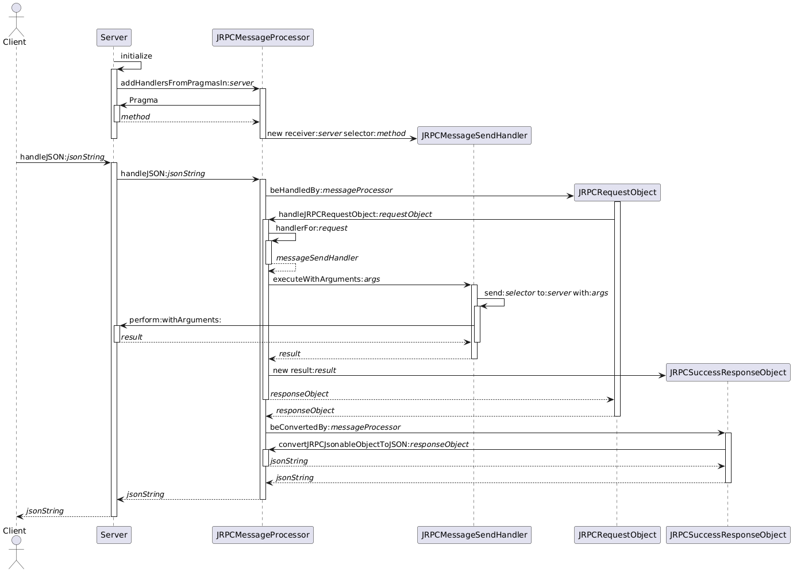

# Message Processing

JSON-RPC messages are processed by instances of `JRPCMessageProcessor` independently of the underlying transport used to receive the messages and respond to them.

The message processor has a list of method handlers available that will be searched when an incoming message is received. If a suitable handler is found (the `#methodName` is matching) then it gets executed with the parameters provided in the message.

A message processor can be configured using the following messages:
- `addHandlerNamed:block:` adds a new handler for a method that will evaluate the block provided as argument.
- `addHandlersFromPragmasIn:` searches the methods of the object provided as argument for `<jrpc: 'methodName'>` pragmas, and adds one handler per pragma found. The pragma's argument is the remote method name, and the method carrying the pragma is the one sent to the object when a matching JSON-RPC message is received.
- `addHandler:` adds a new handler. Handlers must subclass `JRPCAbstractHandler`, this allows the end user to extend the available options if needed.

The message processor main API is `handleJSON:`, any server implementing a specific transport protocol must obtain the JSON string and delegate its processing by sending `handleJSON:` to the processor. `handleJSON:` answers the JSON string to send back to the client once the processing is completed.

## Message handlers

Message handlers are responsible for executing the code related to a JRPC method. All handlers are subclasses of `JRPCAbstractHandler` and need to provide a `methodName` and a way to execute this method with the provided arguments. Two implementations are already available: `JRPCBlockHandler` and `JRPCPragmaHandler`.

- `JRPCBlockHandler` instances are created with a block closure that will be evaluated to compute the method. The parameter names are taken from the block parameters names.
- `JRPCPragmaHandler` instances search their receiver's class for the single method carrying a `<jrpc>` pragma, which takes no argument, and raise an error unless exactly one method carries it. Subclasses must define `defaultMethodName`, returning the name of the remote method, and the code executed is the one in the method carrying the pragma, whose parameter names are the handler's.

This is the UML sequence diagram of how a JSON-RPC server processes a message: 

